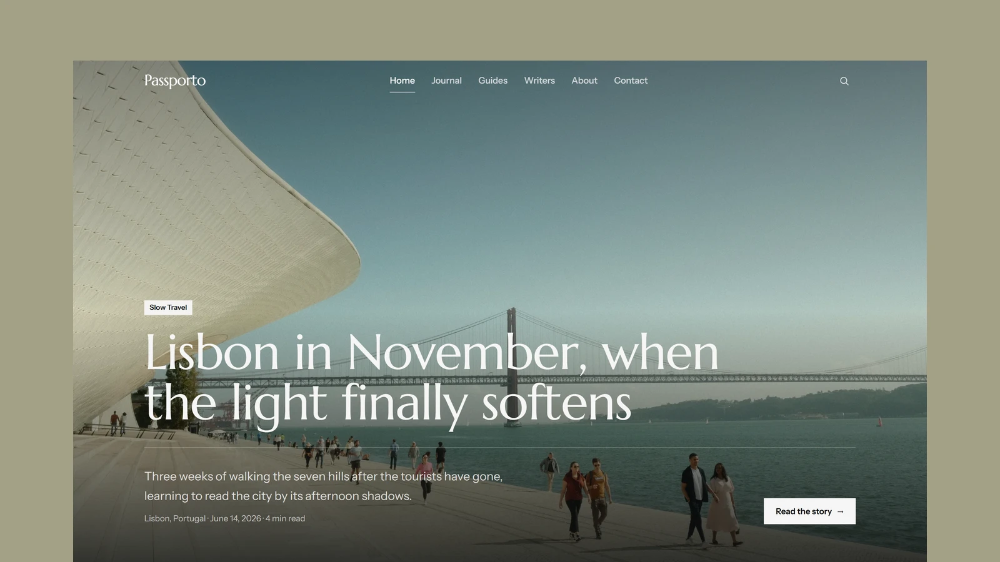

# Passporto - Astro Travel Theme

[](https://passporto.xocoweb.workers.dev/)

[](https://astro.build/)
[](https://tailwindcss.com/)
[](https://www.typescriptlang.org/)
[](./LICENSE)

**Live preview:** [https://passporto.xocoweb.workers.dev/](https://passporto.xocoweb.workers.dev/)

Passporto is a literary, editorial Astro theme for slow-travel journals, city guides, and independent travel writing publications. It is built for mostly static output, fast article pages, crawlable content, and easy customization.

## Features

- Homepage hero and "Featured stories" cards driven by `featured: true` in post frontmatter
- Destination spotlights, latest stories, section tiles that open the journal pre-filtered, and the writers
- Journal archive with category filtering, linkable `?category=` views, and "load more" pagination
- Long-form article pages with a full-bleed cover, editorial prose typography, and an author card
- Share card at the end of every story, using the native share sheet on phones
- Destination guide pages with a sticky section nav, essentials, a day-by-day itinerary, neighbourhoods, a photo essay, practical notes, and an optional video
- Writers (authors) index and profile pages, each with their own bylined stories
- Markdown content powered by typed Astro content collections (`posts`, `destinations`, `authors`)
- Reading time is calculated automatically from each post's markdown body
- Every cover, gallery, photo essay, avatar image, and destination-guide video ships with `creditName`/`creditUrl` frontmatter and an on-page credit line
- Central site, navigation, social, and SEO defaults
- Canonical URLs, sitemap generation, RSS, robots, Open Graph, Twitter/X cards, and JSON-LD
- Justified photo gallery that shows every photo at its own proportions, with a keyboard-accessible lightbox
- Header that sits transparent over the hero, hides on scroll down, and returns on scroll up
- Search palette (`Cmd/Ctrl+K` or `/`) that stays empty until you type, plus a full-archive search page
- Responsive Astro image handling with Sharp; Marcellus and Instrument Sans are self-hosted, with no font CDN requests
- Footer with a provider-neutral newsletter sign-up and social icons, plus static about, contact, and colophon starter pages

## Tech Stack

- Astro 7
- Tailwind CSS 4 via the Vite plugin
- Vite 8
- TypeScript
- Astro content collections
- `@astrojs/mdx`
- `@astrojs/sitemap`
- `rehype-slug`
- Sharp for image processing

## Requirements

- Node.js `22.12.0` or newer
- npm

## Getting Started

```bash
npm install
npm run dev
```

Build for production:

```bash
npm run build
```

Preview the production build locally:

```bash
npm run preview
```

Format the project:

```bash
npm run format
```

Run the release QA checks:

```bash
npm run release:check
```

## First-Time Setup

1. Update the main site settings in [src/config/site.ts](./src/config/site.ts):

- `name`
- `tagline`
- `title`
- `description`
- `siteUrl`
- `authorName`
- `email`
- `locale`
- `socialImage`
- `newsletter`
- `socials` (label, link, and icon for each network in the footer)

Navigation links live in the `navigation` array in the same file. Update it when you add, remove, or rename sections.

2. Update package metadata in [package.json](./package.json):

- `name`
- `description`
- `author`
- `homepage`
- `repository`

3. Replace the preview assets:

- [preview.webp](./preview.webp) — README/marketplace preview image
- [public/favicon.svg](./public/favicon.svg)
- [public/og-image.jpg](./public/og-image.jpg)

## Content Editing

Content lives in three collections under [src/content](./src/content), each entry a folder with an `index.md` and its own colocated images:

### Posts — [src/content/posts](./src/content/posts)

```yaml
title: "Story title"
dek: "Short subtitle for cards and metadata."
category: "Slow Travel"
date: 2026-06-14
location: "Lisbon, Portugal"
author: nora-alviar
featured: false
draft: false
cover:
  src: ./cover.jpg
  alt: "Useful image description"
  creditName: "Photographer Name"
  creditUrl: "https://unsplash.com/@photographer"
gallery:
  - src: ./gallery-1.jpg
    alt: "Useful image description"
    caption: "Optional narrative caption."
    creditName: "Photographer Name"
    creditUrl: "https://unsplash.com/@photographer"
```

`author` references a slug in the `authors` collection. `category` must match a value in [src/config/categories.ts](./src/config/categories.ts). Set `featured: true` on posts to feature them: the newest featured post leads the homepage hero, and up to three more appear as "Featured stories" cards. With none featured, the hero uses the latest post. Posts can be `index.md` or `index.mdx`. Gallery photos show as one justified photo set after the article; in an `.mdx` post, put `<Gallery />` on its own line to place that set anywhere in the text instead. Single images can go anywhere with normal markdown image syntax.

Reading time is calculated automatically from the post's markdown body at build time, so posts do not need a `readMinutes` frontmatter field.

### Destinations — [src/content/destinations](./src/content/destinations)

Each destination guide holds `name`, `country`, `tagline`, `intro`, `bestTime`, `cover`, `things`, `stay`, `food`, and optional `neighborhoods`, `itinerary`, `getting`, `costs`, `reads`, `language`, `video`, `photoEssay`, and `coords` fields. See any file in [src/content/destinations](./src/content/destinations) for the full shape.

### Authors — [src/content/authors](./src/content/authors)

```yaml
name: "Author Name"
role: "Founding Editor"
location: "Currently in Porto"
avatar:
  src: ./avatar.jpg
  alt: "Portrait of Author Name"
  creditName: "Photographer Name"
  creditUrl: "https://unsplash.com/@photographer"
---
Author bio, written as the markdown body of the file.
```

## Customization

Global theme tokens and reusable utility classes live in [src/styles/global.css](./src/styles/global.css). Start there for colors, typography, spacing, borders, focus styles, and shared interaction states.

Reusable components live in [src/components](./src/components):

- `Newsletter.astro`
- `PhotoGallery.astro`
- `PostCard.astro`
- `SiteFooter.astro`
- `SiteHeader.astro`
- `VideoPlayer.astro`

Layouts live in [src/layouts](./src/layouts). `BaseLayout.astro` owns shared metadata, structured data, and global CSS.

Pages live in [src/pages](./src/pages). The main templates are:

- Home: `index.astro`
- Journal index: `blog/index.astro`
- Article detail: `blog/[slug].astro`
- Destination guide: `destinations/[slug].astro`
- Guides index: `guides/index.astro`
- Writers index: `authors/index.astro`
- Writer profile: `authors/[slug].astro`
- About: `about.astro`
- Contact: `contact.astro`
- Colophon: `colophon.astro`
- RSS: `rss.xml.ts`
- Robots: `robots.txt.ts`
- 404: `404.astro`

For detailed customization notes, see [CUSTOMIZATION.md](./CUSTOMIZATION.md).

## SEO

The theme uses `siteConfig.siteUrl` from [src/config/site.ts](./src/config/site.ts) to generate absolute URLs for canonical tags, social images, RSS, robots, and the sitemap. Update it before publishing.

SEO-related files:

- [src/layouts/BaseLayout.astro](./src/layouts/BaseLayout.astro)
- [src/config/site.ts](./src/config/site.ts)
- [astro.config.mjs](./astro.config.mjs)
- [src/pages/rss.xml.ts](./src/pages/rss.xml.ts)
- [src/pages/robots.txt.ts](./src/pages/robots.txt.ts)
- [public/favicon.svg](./public/favicon.svg)
- [public/og-image.jpg](./public/og-image.jpg)

## Deployment

Deploy as a standard static Astro site on Vercel, Netlify, Cloudflare, or any static host.

For Cloudflare Workers static assets, this theme includes [wrangler.jsonc](./wrangler.jsonc). Use:

- Build command: `npm run build`
- Deploy command: `npx wrangler deploy`

Before launch:

- Set `siteUrl` in [src/config/site.ts](./src/config/site.ts)
- Replace demo posts, images, authors, credits, and contact details
- Replace the destination-guide videos with your own footage, or keep the credited stock clips, or remove that section
- Replace the favicon, preview, and Open Graph images
- Confirm `homepage` and `repository` in [package.json](./package.json)
- Run `npm run release:check`
- Check generated canonical URLs, RSS, robots, and sitemap output
- Test keyboard navigation, focus states, mobile layout, and color contrast

For packaging, support, and version history, see:

- [SUPPORT.md](./SUPPORT.md)
- [CHANGELOG.md](./CHANGELOG.md)

## Template Catalogue Notes

This package is configured as a paid commercial template. It is marked `"private": true` to prevent accidental npm publishing, and the package license points to the custom license text in [LICENSE](./LICENSE).

The included demo content is realistic placeholder editorial content, and every demo image and destination-guide video is real and credited (Unsplash photographs, Pexels video clips). Buyers should replace it before publishing a real site and verify rights for any media they keep.

## License

Passporto is licensed under the [Passporto Commercial Template License](./LICENSE).

## Credits

- [Marcellus](https://fonts.google.com/specimen/Marcellus) and [Instrument Sans](https://fonts.google.com/specimen/Instrument+Sans), SIL Open Font License 1.1
- Share icons from [Bootstrap Icons](https://icons.getbootstrap.com/), MIT License
- Demo photographs from [Unsplash](https://unsplash.com/) and video clips from [Pexels](https://www.pexels.com/), credited in each entry's frontmatter
