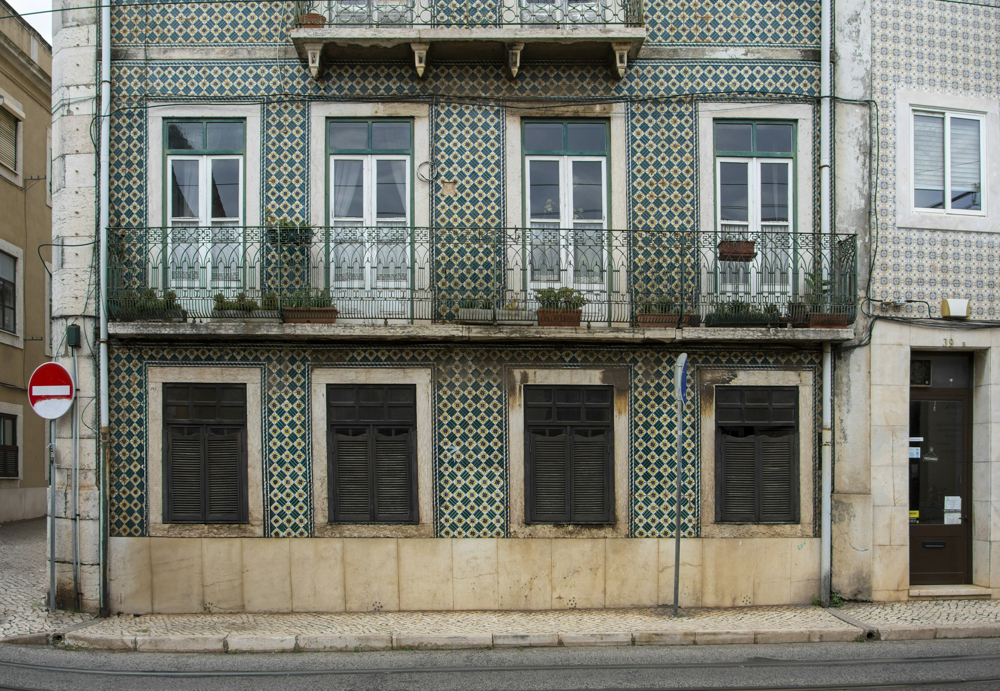

The rent in Alfama had a rule attached to it: leave the shutters half open, always. My landlady, Célia, said it was so the house could breathe. What it really meant was that at four in the afternoon a long slab of amber light would come across the tile floor and stay there until the church bells started up on the hill.

November is when Lisbon becomes itself again. The cruise ships thin out. The miradouros are quiet on weekdays. You can order a bica at Café A Brasileira without waiting in a queue that snakes past Pessoa's bronze knees, and the waiters have time to argue with you about football.

## Why November

Most people come in summer, when the city is loud and hot and the queue for the castle runs down the hill. November is different. It rains, but rarely for long, and when it stops the stone pavements shine like they have been polished for you.

- **The light.** The sun sits low all day, so every street looks like late afternoon by two o'clock.
- **The prices.** Apartments drop by a third after October, and you can stay longer for the same money.
- **The food.** Roasted chestnuts on every corner, the first of the new wine, and bacalhau back on every menu.
- **The quiet.** You can stand at a miradouro for twenty minutes and hear nothing but gulls and a radio somewhere below.

## A walking week

I gave myself a rule: no metros for seven days. Lisbon punishes you for it in calves and rewards you for it in the small things: the woman who sells roasted chestnuts near Largo do Carmo and always has an extra one for the dog waiting outside the pharmacy, or the tiled façade on Rua da Bica that changes colour completely between nine in the morning and three in the afternoon.

<figure class="wide">

<figcaption>Azulejos and iron balconies on a side street. Photo: Milan Trninic / Unsplash</figcaption>
</figure>

The tiles are the thing you notice first and understand last. They keep houses cool in summer and dry in winter, and every street seems to have agreed on a different pattern. By the end of the first week I had a favourite, a green-and-white diamond on a corner building in Graça, and I walked past it most mornings on purpose.

<blockquote>
  Cities you love the most are the ones you learn to be bored in.
  <footer>— Célia, over dinner</footer>
</blockquote>

## A November day, roughly

After a few days the walks settled into a shape. It wasn't a plan so much as a habit, and it is still the way I would spend a day here:

1. Coffee and a pastel de nata standing at the counter, before nine.
2. One neighbourhood on foot, uphill first while the legs are fresh.
3. A long lunch, the prato do dia, wherever the locals are already sitting.
4. A nap with the shutters half open, as Célia insisted.
5. A miradouro for the last hour of light, then dinner late.

<Gallery />

## What I actually did

Ate grilled sardines standing up at Cervejaria Ramiro. Took the 28 tram once, out of obligation, then never again. Spent an entire Sunday at LX Factory watching a bookseller argue in three languages about a first-edition Saramago.

On the second weekend I took the train out to Belém and found it almost empty. The tower stood in the low sun with nobody in front of it, and the custard tarts at the old bakery came warm with no queue at all.

## If you go

- **Stay** in Alfama or Graça, high enough for a view and close enough to walk down for dinner.
- **Pack** shoes with grip. The limestone pavements are beautiful and slippery after rain.
- **Buy** a Viva Viagem card at the airport and load it once; it works on the metro, trams, and ferries.
- **Skip** the tram 28 queue at Martim Moniz. Walk the route instead and you will see more.

By the third week I could tell time by the trams. That, more than any monument, is the souvenir I brought home.
